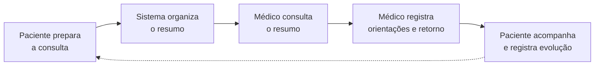
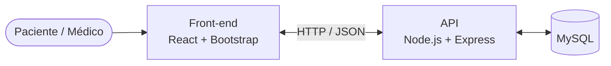
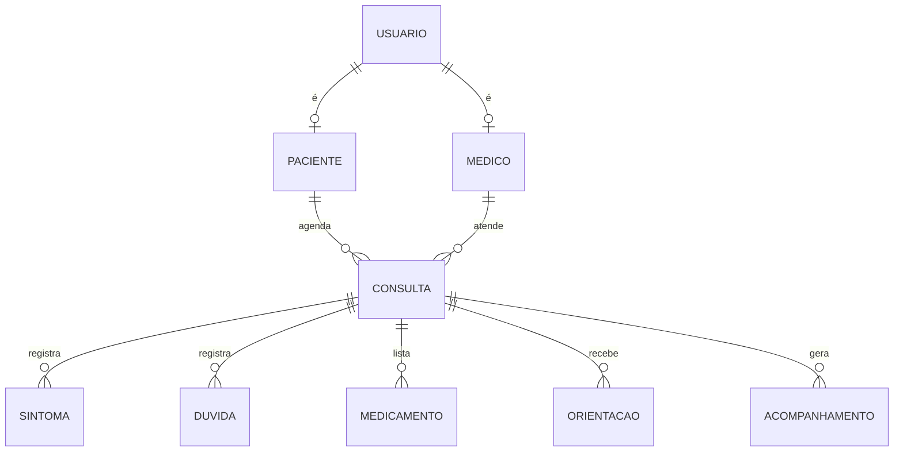

<div align="center">

---

## Sobre

Consultas costumam ser curtas, e muita coisa se perde nelas: o sintoma que começou há semanas, a dúvida que o paciente esqueceu de perguntar, o nome do remédio que ele já toma. Depois, as orientações ficam num papel ou na memória.

O **MedTrack** organiza essas duas pontas. Antes da consulta, o paciente registra motivo, sintomas, dúvidas e medicamentos em uso, e o sistema monta um **resumo estruturado** para o médico. Depois, as orientações, o retorno e os registros de acompanhamento ficam disponíveis em um só lugar.

> [!IMPORTANT]
> O MedTrack é uma ferramenta de **organização e comunicação**. Ele não realiza diagnósticos, não sugere tratamentos e não substitui a avaliação médica.

## Como funciona



1. **Preparação**: o paciente responde a um questionário pré-consulta e registra sintomas, dúvidas e medicamentos.
2. **Resumo**: as informações viram um resumo objetivo, pronto para apoiar o atendimento.
3. **Consulta**: o médico acessa o resumo do paciente na sua agenda.
4. **Orientações**: após o atendimento, o médico registra condutas, medicamentos, data de retorno e próximos passos.
5. **Acompanhamento**: o paciente consulta as orientações e registra como está evoluindo até o retorno.

## Funcionalidades

<table>
<tr>
<th width="50%">Paciente</th>
<th width="50%">Médico</th>
</tr>
<tr>
<td valign="top">

**Privacidade por padrão:** cada usuário acessa apenas o que o seu perfil permite. As restrições são aplicadas na interface e, principalmente, na API.

## Arquitetura

O sistema segue uma arquitetura em três camadas: interface, regras de negócio e persistência ficam separadas, e toda comunicação com o banco passa pela API.



| Camada                   | Tecnologias                             | Responsabilidade                                       |
| ------------------------ | --------------------------------------- | ------------------------------------------------------ |
| **Front-end**      | React, JavaScript, HTML, CSS, Bootstrap | Telas, navegação e comunicação com a API           |
| **API**            | Node.js, Express                        | Validação, regras de acesso e operações do sistema |
| **Banco de dados** | MySQL                                   | Usuários, consultas e registros do atendimento        |

<details>
<summary><b>Modelo de dados (visão geral)</b></summary>

<br/>



</details>

## Estrutura do repositório

```
medtrack/
├── frontend/     # Aplicação React (interface do paciente e do médico)
├── backend/      # API Node.js + Express
└── README.md
```

## Executando localmente

> [!NOTE]
> O projeto está em desenvolvimento. Enquanto a API não está disponível, o front-end pode rodar com dados simulados.

**Pré-requisitos:** Node.js 18+ e npm. MySQL 8+ será necessário para a API.

```bash
# Clone o repositório
git clone <url-do-repositorio>
cd medtrack

# Front-end
cd frontend
cp .env.example .env
npm install
npm run dev
```

| Variável         | Descrição                                                                |
| ----------------- | -------------------------------------------------------------------------- |
| `VITE_API_URL`  | Endereço da API                                                           |
| `VITE_USE_MOCK` | `true` para usar dados simulados enquanto a API não estiver disponível |

As instruções da API serão adicionadas assim que o back-end estiver disponível.

## Roadmap

- [X] **Etapa 1: Planejamento**: requisitos, casos de uso, modelo de dados e wireframes
- [ ] **Etapa 2: MVP**: interface responsiva, CRUD de consultas, preparação, resumo e acompanhamento básico integrados ao banco
- [ ] **Etapa 3: Entrega final**: autenticação completa, pesquisa e filtros de consultas, refinamento da interface e hospedagem online

## Equipe

| Integrante                    | Papel                   |
| ----------------------------- | ----------------------- |
| **Gabriel Meneses**     | Gerente de Projeto      |
| **Yuri Freitas**        | Design / UX-UI          |
| **Pedro Átila**        | Front-end               |
| **Fernando José**      | Back-end                |
| **Gabriel Mascarenhas** | QA / Análise de Testes |

---

<div align="center">
<sub>Projeto acadêmico desenvolvido para a disciplina de Desenvolvimento Web.</sub>
</div>
